<div align="center">

# ✈️ GAURAV SHIVAKUMAR // AEROSPACE & AI/ML SYSTEMS
### **AI/ML & Optimization Lead · Hybrid-Electric UAV Propulsion · Aerothon 2026 Champion**

<!-- Master Animated Aerospace Scene: Sukhoi Su-30MKI Supersonic Launch with Mach Diamonds & HUD Telemetry -->


<br/><br/>

[](https://github.com/gauravmes9a11-alt)
[](https://www.linkedin.com/in/gauravs-378954347)
[](mailto:gaurav.mes9a11@gmail.com)
[-00b4ff?style=for-the-badge&labelColor=0a1128)](https://pes.edu)
[](https://github.com/gauravmes9a11-alt)

<br/>

[](https://developer.nvidia.com)
[](https://developers.google.com)
[](https://github.com/gauravmes9a11-alt)

</div>

---

## 🛰️ Flight Operations & Profile Telemetry

```text
┌────────────────────────────────────────────────────────────────────────────────────────┐
│ FLIGHT OPERATIONS & AVIONICS SPECIFICATIONS                                            │
├────────────────────────────────────────────────────────────────────────────────────────┤
│ > PILOT CALLSIGN : Gaurav Shivakumar (gauravmes9a11-alt)                               │
│ > MISSION        : Build intelligent, physics-guided systems for aerospace and beyond │
│ > COMMAND ROLE   : AI/ML & Optimization Lead @ Team AeroVolt Dynamics                 │
│ > CAMPUS BASE    : B.Tech CSE (AI/ML), PES University, Bengaluru                       │
│ > TOP HONORS     : 🏆 First Place, HAL × IIT Indore Aerothon 2026 (2,600+ teams)       │
│ > AMBASSADOR     : E-Cell IIT Bombay                                                   │
│ > MEMBERSHIP     : NVIDIA Developer · Google Developer · GitHub Developer             │
│ > FLIGHT STATUS  : CLEARED FOR TAKEOFF // MACH 2.2+ SUPERSONIC CLIMB ✈️                 │
└────────────────────────────────────────────────────────────────────────────────────────┘
```

- 🛩️ **Aerospace Propulsion Optimization**: Engineering multi-objective energy management strategies (NSGA-II, ECMS, Rule-Based) for hybrid-electric UAV architectures.
- 🧠 **Deep Learning & Trajectory Prediction**: Developing knowledge distillation frameworks (**LaKD-UAV**) for variable-length autonomous flight trajectory forecasting.
- 🛰️ **Physics-Guided Remote Sensing**: Architecting cross-modal satellite imagery retrieval systems (**PEIRL**) for Earth observation hackathons.

---

## 🧰 Programming Languages & Tech Stack

<div align="center">

### 🧠 AI, Machine Learning & Mathematical Optimization
<a href="https://skillicons.dev">
  
</a>

<br/>

### 💻 Core Languages & Embedded Systems
<a href="https://skillicons.dev">
  
</a>

<br/>

### ⚡ Frameworks, Simulation & Development Avionics
<a href="https://skillicons.dev">
  
</a>

</div>

---

## 💼 Projects

### 💻 Backend Projects

<a href="https://github.com/gauravmes9a11-alt"></a>
<a href="https://github.com/gauravmes9a11-alt"></a>
<a href="https://github.com/gauravmes9a11-alt"></a>
<br/>
<a href="https://github.com/gauravmes9a11-alt"></a>
<a href="https://github.com/gauravmes9a11-alt"></a>
<a href="https://github.com/gauravmes9a11-alt"></a>
<br/>
<a href="https://github.com/gauravmes9a11-alt"></a>

<br/>

### ⚙️ Test Automation Projects

<a href="https://github.com/gauravmes9a11-alt"></a>

<br/>

### 🤖 AI Projects

<a href="https://github.com/gauravmes9a11-alt"></a>
<a href="https://github.com/gauravmes9a11-alt"></a>
<a href="https://github.com/gauravmes9a11-alt"></a>
<br/>
<a href="https://github.com/gauravmes9a11-alt"></a>

<br/>

### 🏷️ Google Labs

<a href="https://github.com/gauravmes9a11-alt"></a>
<a href="https://github.com/gauravmes9a11-alt"></a>
<a href="https://github.com/gauravmes9a11-alt"></a>
<br/>
<a href="https://github.com/gauravmes9a11-alt"></a>
<a href="https://github.com/gauravmes9a11-alt"></a>
<a href="https://github.com/gauravmes9a11-alt"></a>
<br/>
<a href="https://github.com/gauravmes9a11-alt"></a>
<a href="https://github.com/gauravmes9a11-alt"></a>

---

## 🚀 Strategic Deployments & Flagship Missions

<div align="center">

<a href="https://github.com/gauravmes9a11-alt/AeroPulse">
  
</a>
<a href="https://github.com/gauravmes9a11-alt/LAKD-Simulation">
  
</a>
<br/>
<a href="https://github.com/gauravmes9a11-alt/PEIRL">
  
</a>
<a href="https://github.com/gauravmes9a11-alt/Drowsiness-Detector">
  
</a>

</div>

<br/>

| Mission / Repository | Operational Overview | Avionics Stack | Status |
| :--- | :--- | :--- | :---: |
| 🛩️ **[AeroPulse](https://github.com/gauravmes9a11-alt/AeroPulse)** | Real-time aerospace telemetry analytics, flight dynamic modeling, and propulsion monitoring. | `Python` `Streamlit` `NumPy` `SciPy` | `● ACTIVE` |
| 🛰️ **[LAKD-Simulation](https://github.com/gauravmes9a11-alt/LAKD-Simulation)** | Knowledge distillation architecture for variable-length autonomous UAV trajectory forecasting. | `PyTorch` `Deep Learning` `Python` | `● AIRBORNE` |
| 🌍 **[PEIRL](https://github.com/gauravmes9a11-alt/PEIRL)** | Physics-guided cross-modal satellite image retrieval system built for national hackathons. | `PyTorch` `Computer Vision` `GIS` | `● DEPLOYED` |
| ✈️ **[Flight-Management-System](https://github.com/gauravmes9a11-alt/Flight-Management-System)** | Interactive flight operations console: gate assignments, route planning, and fleet scheduling. | `Java` `OOP` `Algorithms` | `● OPERATIONAL` |
| ⚡ **[Drowsiness-Detector](https://github.com/gauravmes9a11-alt/Drowsiness-Detector)** | Edge AI + hardware safety system using MediaPipe EAR and Arduino microcontrollers. | `Python` `MediaPipe` `OpenCV` `Arduino` | `● VERIFIED` |

---

## 📊 Flight Telemetry & Performance Analytics

<div align="center">


<br/>


</div>

---

## 📈 Activity Graph

<div align="center">


</div>

---

## 🎮 Arcade Contribution Games

### 🐍 GitHub Contribution Snake

<div align="center">



</div>

<br/>

### 👻 Pac-Man Contribution Game

<div align="center">



</div>

---

## 🏆 Flight Commendations & Honors

- 🥇 **Grand Finale Winner (1st Place)** — **HAL × IIT Indore Aerothon 2026**
  - Led propulsion optimization for hybrid-electric UAVs against **2,600+ national teams**.
  - Built physics-grounded models with NSGA-II genetic algorithms and ECMS energy distribution.
- 🛩️ **Capstone Research: LaKD-UAV**
  - Architected variable-length knowledge distillation pipelines for UAV trajectory prediction.
- 🛰️ **National Finalist: Bharatiya Antariksh Hackathon 2026**
  - Developed **PEIRL** for physics-guided multimodal satellite image retrieval.
- 🎖️ **Campus Ambassador** — **E-Cell IIT Bombay**
  - Driving entrepreneurial innovation, aerospace workshops, and technological ventures.

---

<div align="center">


</div>